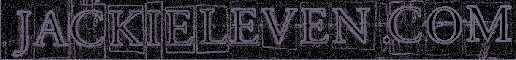

# The Deep Pool – September 2007

A
ugust 2006

March 2003a

SEPTEMBER 2007

THE DEEP POOL

And now it is the time of the year when the great sad golden chord shall sound - a chord named by Doll By Doll guitarist, the wonderful Joe Shaw as 'Summer's End'. The chord by the way is E A B E A B. I probably mention that every year, but hell, so many good things in life only get mentioned once a year - sex on planes, Korean food - the list is mindless...

And the chord has not sounded yet - it's just that i'm soon to go on tour in Scandinavia, and by the time i get back the chord may well have struck, been and gone, leaving children sprawled on the pavement with their laptops covered in chestnuts saying 'what the fuck was THAT noise?'

Speaking of laptops and chestnuts, a few moments ago i was sunbathing down in the walled fruit garden next to the apple trees and rosemary when my white terrier Basil jumped on me and dropped a vile rotten maggoty apple on my bollocks. Why can't he play with nice new ones which have just fallen, the bastard? To be fair, sometimes he picks his own apples from the lower branches, and that really is worth seeing: he gingerly stands on his back legs, swaying back and forth until he gets a small one between his teeth, then pulls and twists with a low growl to show the tree who's boss, then BLANG!, the apple comes free and Baz sprawls on the ground in triumph as the young tree shakes itself in affront. But he's not sure about the taste of newly picked ones - he seems to prefer them when they've become soft, brown and fermentational, then he puts his snout in them and pushes them around the flagstoned yard until they become squished around the trunk of the vine beneath the bench by the donkey stable.

A most moving moment a few mornings back - i took both terriers for a walk up by the gypsy stockade and along the side of a field of seven foot high sweetcorn. Down at ground level the earth is hard and ochre and the cornstalks are surprisingly thick and uniform - the corn makes an eerie green rustling sound in the slightest wind, which seems to say 'weee knnow wwhhere you livve annd wee'll come in yourrre windowww one nightttt - haaaaa!'. The dogs are always unsettled by this sound and glance at me nervously for basic reassurance. The other day Ronnie (brown terrier) decided to go and stand among the stalks to see what that might be like. He stood stock still with his head tilted, ear cocked, communing with the Corn Divinity. It was like looking at a naive art painting and something about the tenderness of it made me quite unexpectedly tearful. Suddenly Frank Page's hens appeared, strutting through the stalks towards Ronnie with no fear at all. I though, was petrified - Frank is a terrifying demi-urge of the very first order, a sort of local Romany warlord who is so barred from our local pub that there is a plaque above the door to commemorate the barring occasion - not the kind of guy whose hens you would want your terriers to eat. Ronnie took a huge initial interest in the hens, exotic fierce-looking bastards of unknown provenance, and both he and Baz looked at me, waiting for the order to destroy.

'No' i said quietly in my best voice of death, normally reserved for psychopaths in Rotterdam public toilets. To their great credit they just stood watching the enigmatic parade of pullets, one of whom actually sniffed Ronnie's arse, before deciding there was something better happening further down the field, passing from our sight with sporadic 'wok wok' noises.

So, here we are at that time of year where we're about to climb together towards the darkness, so for me it's a time of looking back at the year so far, but at the summer in particular. As you get older (woozy violins) i think summer becomes more important, or maybe more significant - summer as a sign - no, i can't really live with that notion. Last year summer seemed to simply disappear before i could really understand that it was happening in the first place, and i made a vow not to let that happen again. That was the principle, but what was the process? It's not possible, nor is it even desirable, to live as if every single moment is precious (whatever a 'moment' is). For that to work you'd have to be conscious of everything all the time, and to pretend you can do this, or are doing this. is a foolish, nay dangerous, posture - even if you're the Dalai Lama, or some smirky Indian child god with a lot of Starsky and Hutch DVDs. If everything's sacred, then nothing is sacred. You can't just be frantic to extrude more 'value' from the commodity that is 'summer' (for instance).

But noticing you can't really feel an entire season is horrible. I think to feel a season you need repetition - to see the same thistle twisted round the same piece of barbed wire and abandoned gate. The broken stile by the railway line where i often walk was recently removed by the farmer - this upset me as it was the only place you could realistically sit on that particular walk. But after a couple of weeks of vague inner turmoil about the 'loss of facility' i noticed that, in fact, i used to sit for a while on the stile in order to feel sorry for myself and the world. I even knew that that was what was happening (those last nine words a personal triumph of mangled expression) when i sat there - indulging in what has been called elsewhere 'a paralysing sense of complaint' - 'it's all so wrong and unjust'). But i did it and let it happen anyway, thereby turning a decent opportunity for generative ritual into mere sentimental ceremony. Like the public gestures of the royal family - rituals reduced to hollow ceremonies.

So what do i remember now about this past summer? I remember me, Michael Weston King and Robert Fisher walking from our hotel in Leeds to the central city market for breakfast after playing the New Roscoe the night before. This is a large stone-built ancient market with everything in it - from fish to saris, and we sat down in a cafe which was also a fish and chip shop. Robert and me thought it would be a good idea to have haddock and chips with mushy peas for breakfast. We were wrong. The haddock reminded me of the time when i was thirteen, had not done my homework, and was forced to suck my arithmetic jotter until it became soggy enough with saliva and tears to chew and swallow - except of course the jotter wasn't covered in batter. And there was no mushy peas. Or chips.

'Everything all right?' asked a cheerful young waitressy Leeds lass, as we sat Buddha-like, chomping through the long division. I replied on both our behalfs as Robert was chasing mushy peas round his plate with the stricken look of a man passing Robbie Williams a clothes brush in the toilet of an upper class brothel in Zurich.

'Wonderful thanks!' i enthused, hoping to make her summer a memorable one in some small but significant way. Robert nodded sightlessly, like someone playing chess with George Bush - 'Can the knight eat the prawns?'

'No'.

But i love love love covered markets, and when i get to cities on tour, i'm anxious until i'm told otherwise that a beloved market not only still exists but is flourishing. When you think of the great markets that have disappeared, even in my time, and to be replaced by what?

VIENNA SNUFF MARKET - replaced by a Korean Snuff Movie Cinema Complex, and the Freud Interactive Museum of Cocaine Paraphernalia.

KABUL POPPY MARKET - replaced by the Heroin Heritage Trail and the televison company headquarters of the people that bring you 'You've Been Maimed' - the Afghan equivalent of 'You've Been Framed' - a gram of good shit for every filmed 'mishap' that they use. I could go on - i won't.

Also i remember going to the city of Newcastle twice for the same festival - Summertyne. I got the date wrong first time, took the train all the way to that great city, took a taxi to the Sage Theatre and stood there understanding that i'd fucked it up. I was too embarrassed to even go to the festival office and say 'Hi! - Jackie Leven! - shouldn't be here! - fucked up the date of my performance! - hahahaha! Bye!'

So i went the week after and had a wonderful time - Blind Boys Of Alabama, Kris Kristofferson, organic cider, hotel with a view of the train station - perfect. I stood later on that warm sunlit evening, leaning on a railing opposite a pub called The Percy Arms. Inside the pub, maddened young geezers in denim jackets with bottle-blonde corkscrew hair threw themselves around whilst listening to 'when you've been - in the wishing WELL!"!! -' DANG-DANG-DANG - DANG-DANG-DANG'...

Further along the pavement a bunch of unimpressed chicks in gold lurex shorts stood impassively watching a group of nutritionally challenged mid-twenties blokes in grey anaoraks doing a thing which was quite - different. With arms round each other, they all fell to the ground in a sort of choreographed way, slowly at first but with increasing speed and an attendant 'WWaaaeeeyyyyeee!!!' noise. Then, and i have to say this was worthy of some respect, they would rise back up, as if a film was being run backwards, going 'YYYYeerrrrrrrooowaHHH!'. The rising kind of defied gravity and must have taken a lot of working out somewhere - presumably an old Napoleonic watchtower in the Channel islands.

One of the lurex girls was wearing a T-shirt that said in pink 'my dad fucks pigs'. It was hard to imagine the process that lead to her feeling that this was a statement she wished to project for an entire evening, unless of course, it was simply true. It reminded me of a time when, towards the end of her life, and in frail mental health, i was walking with my mother back from the esplanade to her flat in Bexhill on the south coast of England. Someone had sprayed the word 'CUNT' on a wall. My mother stopped and looked at this for a long time - well, probably five minutes, but an eternity for me.

'What does that mean?' she asked me.

'I'm not sure' i replied, and we walked on, past a French restaurant that had a sign outside saying 'Classic French Bistro Cuisine'. Underneath was a smaller sign which said 'Wanted - weekend chef - no experience necessary'. No wonder Gordon Ramsay has dents in his face.

And i remember driving with Robert Fisher and Michael Weston King from the Muir Of Ord hotel to Inverness Airport the morning after playing Belladrum Festival.There's something heartstoppingly beautiful about that part of Scotland, especially on a fine summer morning - the colours are unique and Dali-glorious. The last time i'd been at Inverness Airport had been several years earlier, on my way to Findhorn community to start a weekend-long event for men with Robert Bly and Richard Olivier. My father had recently died, and Robert instructed all the men at the event to look hard into my face and eyes as an example of what happens to a man's soul in those inevitable circumstances... working with Robert is like working with David Thomas - as long as you accept and remember that there is danger, you're safe. Later that evening i stood with Mike Scott and Ian MacDonald after a firework display, enjoying peaceful and desultory conversation as the Moray Firth turned silver under an early harvest moon.

Before going to Belladrum i'd flown to Glasgow to stay with the superb Scottish musician, arranger and producer Malcolm Lindsay who is producing an album for Willard Grant Conspiracy (whom incidentally i have joined - 38th member - i'm proud). I was contributing Russian-style choral work and guitar orchestras. The record is going to be stunning - one of the songs - Painter Blue - is in my top ten great songs of all time. The next day i took the train to Inverness. Standing outside the train station at Inverness, waiting for a lift to the festival with Robert and Michael, some fucked up Scots teenagers approached me through the throng of toffee-buying Americans. My guitar in its case was next to me on the station forecourt.

Whispered plan of action between the rake-thin pale squinting lads in Rangers football shirts, then:

'Scuse me pal, but di ye ken wha that guitar belongs tae Only, we could tak it tae that police station if some bastard's loast i''.

'Yeah, it belongs to me'.

'Are ye sure aboot tha?''.

'Of course i'm sure'.

'It's no just been sittin there for a while like, and yer gawn tae nick it?'

No - thanks for being such good citizens, but it really is mine'.

'Can ye prove that pal?- cos if ye cannie ah'm takkin it tae the cop shop'

'I don't have to prove it - it's mine mate - you can trust me on this'.

'Well fuck ye' - the lads moved off, giving me looks of hostile disappointment, and the young mainman took out his frustration by pushing a 'Big Issue' seller over with his foot.

He looked back at me to gauge my reaction to this piece of mild aggro which i had caused by my unreasonable insistence that i owned my own guitar. I gave him a sad but warm smile and an approving nod. He took a white handkerchief out of his jeans pocket and waved it around his head in a mystical circular motion whilst walking backwards at speed, then turned suddenly and walked down a side street followed by his clan.

jl

