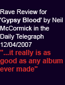

# More grey but warm days in Levenland, bunches of…

More grey but warm days in Levenland, bunches of grapes beginning to ripen on the vines around the ancient donkey stable in the fruit garden – damsons and apples aplenty but already the gooseberry bush leaves are turning yellow. The cooking apples fall and the terriers pick them up and chase round the garden with them, both scandalized but fascinated by how sour the juice is: they’re eating about three a day each and I worry that they’ll get sore guts, but no problems so far.

Below - info on a festival me and Michael Cosgrave are doing in Dublin later in the month. We’re there for a few days rehearsing with the people below for the event, but what the hell are we going to do in Dublin in the evenings after work? That is the question me and Mike ask ourselves. We’ll just have to sit in a bar somewhere and think about that – maybe The Flowing Tide, or, Mike’s favourite, Hegarty’s Old Tissue Box. I daresay if the bar shuts and we STILL haven’t thought of anything to do of an evening we’ll just have to go for a curry then go and watch telly at the hotel – we musicians don’t have as much imagination as folk seem to think – we’re also not half as modest as we think we are….

And finally, I recently partook in an article for the Guardian Newspaper, publication to coincide with next studio album release – it’s for the Saturday weekend colour supplement and is called ‘Q & A’. The same questions get asked of different people every week – here is a sneak preview of my responses……

IMRAM FESTIVAL

Friday 25 September at 8.00pm

CRAWDADDY

Old Harcourt Station

Harcourt Street

Dublin 2

Admission € 10

Bi-lingual event with poems in powerpoint

CAPTIVE LIONS: The poetry of Anna Akhmatova, Vladimir Mayakovsky and Marina Tsvetaeva

TRANSLATED INTO IRISH AND ENGLISH BY NUALA NÍ DHOMHNAILL, TOMÁS MAC SÍOMÓIN AND PAULA MEEHAN

MUSIC BY JACKIE LEVEN, MICHAEL COSGRAVE AND THE GAELIC JAZZ PROJECT

Of Marina Tsvetaeva , Joseph Brodsky said ‘there has been no more passionate voice in twentieth-century Russian literature’ . Anna Akhmatova – ‘the Soul of the Silver Age’

of Russian poetry – was condemned as ‘a bourgeois element’ in 1922, and her poetry was banned. Her later pieces gave voice to the suffering of the Russian people. Vladimir

Mayakovsky , the bard of the revolution, has been described as ‘a genius, a hipster, a shill, and the first and only early-Soviet rap star’. Tonight Nuala Ní Domhnaill and Tomás Mac Siomóin will read stunning new versions of Tsvetaeva and Mayakovsky in Irish; whilst Paula Meehan will perform new work in English inspired by Akhmatova’s ‘Secrets of The

Craft’. They will read to a musical backdrop created by acclaimed singer Jackie Leven , multi-instrumentalist Michael Cosgrave , and Seán Óg of the Gaelic Jazz Project .

GUARDIAN ‘Q & A’ for forthcoming publication:

WHEN WERE YOU HAPPIEST? – some years ago, sitting alone on the beach at Ganavan sands near Oban watching the ferry steam over to the island of Mull.

WHAT IS YOUR GREATEST FEAR? – being sectioned whilst failing to understand WHY?...

WHAT IS YOUR EARLIEST MEMORY? – I don’t know

WHICH LIVING PERSON DO YOU MOST ADMIRE, AND WHY? – I have come to revere the artist Grayson Perry for the beauty of his words and the power of his work.

PROPERTY ASIDE, WHAT’S THE MOST EXPENSIVE THING YOU’VE BOUGHT? – I’ve never bought property, I once bought a lot of uncut cocaine – I use a hair conditioner called Aveda which smells just like it – every time I wash my hair I think I’m out of my head.

WHAT IS YOUR MOST TREASURED POSSESSION? – a tiny toy bear called Bonnie – she used to have a pal called Beanie, but he got lost.

WHAT MAKES YOU UNHAPPY? – lots of things – pigeons whose feet have been crippled by that shit people put on building ledges to cripple their feet.

WHO WOULD YOU INVITE TO YOUR DREAM DINNER PARTY? – a dream dinner party? Blimey! – er, Damon Runyon, H L Mencken and Dorothy Parker.

WHAT IS YOUR FAVOURITE SMELL? – peppercorns.

WHAT IS YOUR FAVOURITE BOOK? – Facing The World With Soul, by Robert Sardello.

CAT OR DOG? – love ‘em both – gone off big dogs.

WHAT DO YOU OWE YOUR PARENTS? – my constant sense of the mystery of it all.

WHAT IS YOUR GUILTIEST PLEASURE? – watching old episodes of The Bill at 9 in the morning.

WHAT OR WHO IS THE GREATEST LOVE OF YOUR LIFE? – my chick.

WHAT HAS BEEN YOUR BIGGEST DISAPPOINTMENT? - too overwhelming to get in sequence.

HOW DO YOU RELAX? – shuffling around second hand book shops – I recommend The Archive in Bell Street off Edgware Road in London – wonderfully shit street market there on Saturday mornings – makes for a perfect winter’s day out.

HOW OFTEN DO YOU HAVE SEX? – three times a day.

WHAT DO YOU CONSIDER YOUR GREATEST ACHIEVEMENT? – like the Bee Gees – ‘stayin’ alive.’

HOW WOULD YOU LIKE TO BE REMEMBERED? – he was faithful to his motto – ‘never knowingly conscious’.

WHAT IS THE MOST IMPORTANT LESSON LIFE HAS TAUGHT YOU? – check you haven’t left your Aveda conditioner in the hotel shower cubicle.

WHERE WOULD YOU MOST LIKE TO BE RIGHT NOW? – having a drink with Spiros in his bar in Loggos on the island of Paxos.

TELL US A SECRET – that’s not strictly a question is it? Secrets are toxic mysteries – that’s not strictly a secret, but I’ll bet you didnae ken it.

------------------------------------

